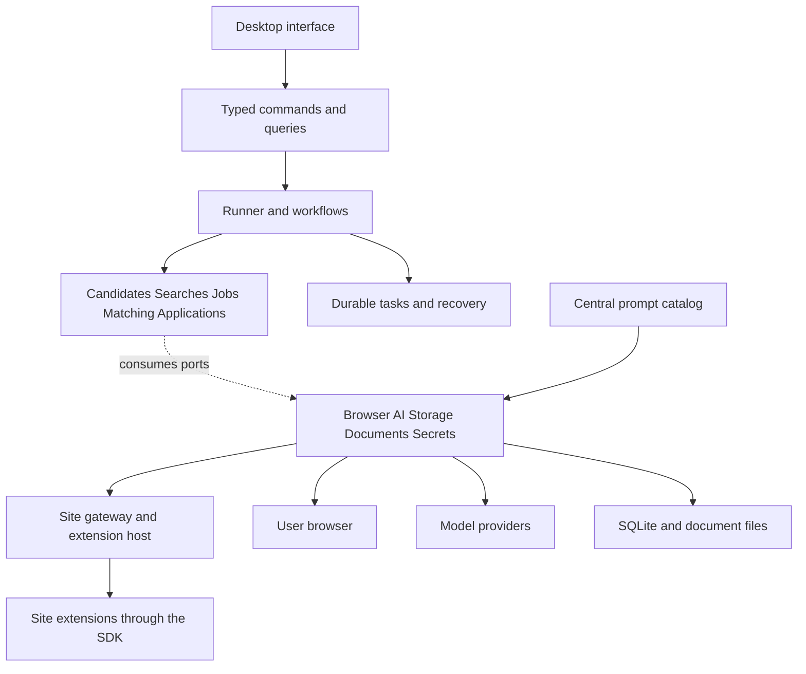

# JobLoop rewrite architecture

Status: superseded on 2026-10-09. This application is simplified in place instead of rewritten: job search only, a generic core with job-specific behavior in `app/templates/job-search/`, Telegram kept. The findings below still describe the code being split. Original status: proposed implementation blueprint. The confirmed product is a desktop application that finds jobs, evaluates fit, applies automatically under the user's configured rules, and tracks applications. Data stays local and automation uses the user's browser. Product code, interface copy, documentation, tests, and authored model instructions are English.

Build a modular monolith with five business modules, a first-class site extension system, explicit dependency boundaries, and one central prompt package. The application controls workflow, authorization, persistence, and recovery. Site extensions supply website-specific knowledge through a common SDK. Models interpret documents, listings, and forms through bounded tasks.

This document plans the rewrite. The package layout, checks, and behavior below are implementation requirements, not claims about the current application.

## Current architecture findings

The existing implementation provides useful behavior to preserve, including task ownership, duplicate detection, uncertain submission handling, and temporary browser evidence held in RAM. Its current boundaries make those behaviors difficult to change independently:

- [automation-store.mjs](../app/automation/store.mjs) combines persistence, scanning, scoring, questions, source recovery, and record operations. It also imports scoring behavior from the renderer directory.
- [automation-worker.mjs](../app/automation/worker.mjs) combines tool definitions, prompts, browser operations, scoring, and execution coordination.
- [templates/job-search](../app/templates/job-search/template.mjs) represents job search through the generic automation template and record model.
- [check.mjs](../scripts/check.mjs) currently checks JavaScript syntax. It does not enforce architectural import boundaries.
- [site-extensions/index.mjs](../app/site-extensions/index.mjs) registers DOM readers, HTTP readers, and CLI/API collectors with different contracts. Site knowledge also remains in files outside extension folders. The rewrite gives these integrations one capability contract and one extension boundary.

The rewrite should preserve verified behavior through focused contract tests while giving each responsibility a clear owner.

## Product boundaries

The first release includes candidate facts and CVs, saved searches and sources, job discovery, matching explanations, automatic application preparation and submission, recovery, application tracking, and the site extension SDK and host. Automatic submission is part of the first complete release. Existing site integrations migrate into this system, and adding another supported site must not require edits to business modules.

The user configures application rules once. Eligible applications proceed without a confirmation for every submission. Missing required facts, access barriers, unsupported forms, and uncertain submission outcomes become actionable exceptions.

The main screens are Overview, Profile, Searches, Jobs, Applications, Activity, and Settings. Each screen presents business state. Agent transcripts and browser diagnostics are secondary inspection views.

The scope excludes a general automation designer, arbitrary templates, configurable record schemas, and unrelated housing or appointment workflows. Existing non-job data remains in the old application and its backups. Email synchronization, Telegram integration, and a marketplace for downloaded third-party extensions are later, separately scoped features. Site extensions are part of the foundation. Initial tracking uses saved confirmations, supported portal observations, and manual status updates; it does not promise automatic discovery of every employer response.

## Runtime and technology decisions

Use Electron for the desktop shell, React and strict TypeScript for the interface, TypeScript for business logic and orchestration, and SQLite for local persistence. These are proposed implementation choices. Retaining Electron preserves the existing desktop packaging investment; TypeScript makes module contracts explicit.

Run the application engine in one supervised Electron utility process. The main process owns windows, tray behavior, updates, OS dialogs, and process lifecycle. The renderer presents state and sends validated commands. The utility process owns workflow and database access. This division follows Electron's documented [process model](https://www.electronjs.org/docs/latest/tutorial/process-model).

Keep context isolation enabled and expose explicit preload methods with validated arguments. Renderer code cannot access Node, the database, model providers, or browser automation directly. Electron documents this approach in its [context isolation guidance](https://www.electronjs.org/docs/latest/tutorial/context-isolation).

SQLite has one write owner in the runner, short transactions, foreign keys, and WAL mode. No transaction remains open while waiting on a browser or model. WAL supports concurrent readers but still allows only one writer at a time, as described in the [SQLite WAL documentation](https://www.sqlite.org/wal.html).

Jev and the existing agent provider integration initially remain behind adapters. The existing Rust and TermLoop bridge can supply process and session management while the new core is written. It owns no job rules, prompts, application statuses, or database mutations. Vendor code remains pinned and subject to its existing license and checksum requirements.

The app can continue in the tray when its window closes. Explicit quit stops execution. Scheduling operates while the app and computer are running. After sleep or restart, overdue searches are coalesced into bounded runs rather than replayed as a burst.



The diagram shows runtime collaboration. Source dependencies point inward: adapters implement contracts owned by the core and runtime.

## Repository layout

Use a pnpm workspace with a small number of packages. Business modules remain folders inside the core package; they do not require separate services or deployment pipelines.

```text
apps/
  desktop/src/
    main/                       # Windows, lifecycle, OS integration
    preload/                    # Narrow command and query bridge
    renderer/
      features/                 # overview, profile, searches, jobs,
                                # applications, activity, settings
      components/               # Shared presentation primitives
      copy/en.ts                # Application-owned interface copy
  runner/src/
    main.ts
    composition-root.ts         # Constructs and wires implementations

packages/
  core/src/
    candidates/
    searches/
    jobs/
    matching/
    applications/
  runtime/src/
    workflows/                  # Coordinates public module use cases
    scheduler/
    queue/
    ownership/
    recovery/
  adapters/src/
    sites/                      # Maps site host results into core ports
    browser/
    agents/
    sqlite/
    documents/
    secrets/
  contracts/src/
    commands/
    queries/
    events/
  site-sdk/src/                 # Manifest, capabilities, results, test kit
  site-host/src/                # Resolution and controlled execution
  prompts/
    src/
      registry.ts
      render.ts
      system/
      tasks/
      fragments/
      tools/
      sites/                    # All site-specific model instructions
    tests/

extensions/
  catalog.ts                    # Explicit registration at composition time
  sites/
    stepstone/
    linkedin/
    himalayas/

native/agent-bridge/             # Existing provider bridge, if retained
tests/
  architecture/
  contracts/
  integration/
  e2e/
  fixtures/
docs/
  architecture.md
  decisions/                    # Short records of consequential decisions
```

Each business module follows the same small layout. Create folders when they contain real responsibilities; do not generate empty scaffolding for every possible layer.

```text
applications/
  domain/
    application.ts
    application-policy.ts
    submission-attempt.ts
    submission-state.ts
  application/
    prepare-application.ts
    authorize-submission.ts
    submit-application.ts
    reconcile-submission.ts
  ports/
    application-repository.ts
    application-form-reader.ts
    application-executor.ts
  index.ts                      # Explicit public exports
```

Use descriptive filenames and explicit named exports. Keep unit tests beside their implementation. Cross-module scenarios belong under root integration tests. Avoid catch-all `manager`, `service`, `helpers`, and `utils` modules; shared code needs a named responsibility and actual consumers.

## Module ownership

| Module | Owns | Public use cases | Does not own |
| --- | --- | --- | --- |
| Candidates | Candidate facts, reusable answers, document metadata and versions | Save profile, import CV, resolve a known answer | Listing fit, browser sessions, submissions |
| Searches | Search criteria, source configuration, schedule preferences, scan coverage | Configure search, plan discovery, record coverage | Applicant facts, application state |
| Jobs | Observed job facts, source URLs, aliases, freshness and availability | Register lead, refresh job, resolve verified duplicates | Candidate scoring, submission decisions |
| Matching | Eligibility, fit scores, reasons, missing facts, assessment versions | Assess job, invalidate stale assessment | Browser actions, permission to apply |
| Applications | Application policy, drafts, attempts, submission evidence, employer status and required user input | Prepare, authorize, submit, reconcile, update tracking | Source pagination, provider session management |

Search sources are part of Searches. Documents are part of Candidates, with physical file handling supplied by an adapter. Application tracking is part of Applications. This keeps closely related rules together without introducing extra business modules prematurely.

Runtime owns the execution lifecycle: task claiming, scheduling, cancellation, resource ownership, and recovery. It has no authority to redefine eligibility or application rules. Adapters translate external systems into the contracts consumed by the business modules.

Every persisted business record has one owning module. SQLite adapters are grouped by that owner, with explicit SQL and migrations. Other modules cannot read its tables directly. Cross-module queries use public query contracts. Runtime workflows coordinate cross-module commands.

## Site extension boundaries

The [site extension design](site-extensions.md) defines the SDK, host, capability contracts, authoring layout, resolution rules, and contract tests. It is part of this architecture.

Each site has one implementation folder under `extensions/sites/<site-id>`. It owns domain matching, endpoint knowledge, selectors, parsing, URL identity rules, form mapping, and interpretation of site receipts. It exposes only the capabilities it implements. Browser DOM extraction, HTTP reads, and API collection all produce the same normalized results.

The site host resolves a capability for the current operation and page, validates its output, and invokes shared browser, network, and model services. A gateway implements core ports using that host. Core and runtime workflows never branch on a website name. Candidate scoring, application policy, persistence, retries, and submission recovery remain shared.

Application extensions propose bounded actions against fresh observations. The shared executor checks authority and performs them, including any API submission. An extension cannot grant permission, mark a submission successful, or directly write application state. A redirect to an employer's applicant tracking system resolves its own extension while keeping the same application and attempt identity.

Site-specific prompt text lives in `packages/prompts/src/sites/<site-id>`. Extension code references prompt IDs through the host. Add a site by implementing SDK capabilities, registering its manifest, adding any central prompt entries, and passing the common contract tests. Existing generic readers remain available for unsupported pages under explicit fallback rules.

## Dependency rules and SOLID

| Area | Allowed dependencies |
| --- | --- |
| Core domain | Its own domain types and small foundational value types |
| Core application use cases | Own domain, own ports, explicitly exported value contracts |
| Runtime | Core public APIs, transport contracts, its own runtime ports |
| Adapters | Core ports, runtime ports, site host public API, site SDK, central prompts, external libraries |
| Site SDK | Neutral schemas, capability contracts, value types; test helpers through a separate export |
| Site host | Site SDK and its own injected browser, network, model and lifecycle ports |
| Site extensions | Site SDK public API and approved pure parsing libraries |
| Prompts | Prompt definitions, neutral input and output schemas, rendering utilities |
| Contracts | Transport schemas and transport data types |
| Desktop renderer | Contracts and UI dependencies |
| Composition root | Runtime, adapters, site host and extension catalog needed for wiring |

Core cannot import Electron, React, SQLite, Jev, provider SDKs, prompts, site extensions, or renderer code. Renderer cannot import core internals or adapters. Business modules cannot import another module's repository or implementation files. Extensions cannot import core, runtime, persistence, raw browser drivers, or another site's internals. Package exports expose supported entry points; dependency checks also enforce boundaries between folders inside core.

Apply SOLID through concrete design rules:

- **Single responsibility:** a policy evaluates rules, a repository persists records, a workflow coordinates steps, and a browser adapter operates the browser. No component combines those roles.
- **Open and closed:** add a provider or approved integration by implementing an existing port and registering it in the composition root. Business rules remain unchanged unless the product behavior changes.
- **Substitution:** every implementation passes shared contract tests for cancellation, timeout, typed results, errors, and ownership. Unsupported capabilities return an explicit result.
- **Interface segregation:** discovery depends on listing reading; submission depends on form execution. Avoid a universal browser or database interface containing every operation.
- **Dependency inversion:** the consuming module owns the port. Concrete dependencies are passed through constructors or factories at startup.

Use plain functions for pure rules and small objects where lifecycle or state requires them. Introduce interfaces at external or module boundaries. A class, base class, repository abstraction, or dependency injection framework is not required for every file.

## Central prompt ownership

`packages/prompts` is the single authored source for all model-facing instructions: system and developer messages, task prompts, shared fragments, tool descriptions, recovery instructions, provider bootstrap instructions, and model-facing guidance returned by tools.

Keep prompts organized within that package rather than combining them into one large file:

```text
prompts/src/
  registry.ts
  render.ts
  system/
    job-assistant.md
  fragments/
    candidate-facts.md
    page-evidence.md
    tool-authority.md
  tasks/
    extract-candidate/
      prompt.md
      definition.ts
    discover-jobs/
      prompt.md
      definition.ts
    extract-job/
      prompt.md
      definition.ts
    assess-match/
      prompt.md
      definition.ts
    prepare-application/
      prompt.md
      definition.ts
    interpret-form/
      prompt.md
      definition.ts
    interpret-submission-evidence/
      prompt.md
      definition.ts
  tools/
    browser.md
    candidate.md
    application.md
  sites/
    stepstone/
    linkedin/
    himalayas/
```

Each task definition declares a stable prompt ID, version, required bindings, input schema, output schema, and included fragments. The prompt package's rendering function validates bindings and composes a typed `RenderedPrompt` inside the runner. Adapters map the validated model output into business types; core use cases still validate business invariants.

Only the agent adapter can invoke a provider. It accepts a catalog-rendered prompt, task scope, cancellation signal, budget, and allowed tools. Application code requests a named task through a port. It cannot pass arbitrary prompt text to a model. The Rust bridge receives already resolved instructions and carries no fallback prompt of its own.

Tool schemas and executable handlers remain with their owning contracts and adapters. Their authored natural-language descriptions come from this catalog and are assembled through the same controlled path. Dynamic tool responses return structured facts and error codes; any instructional text references a catalog entry.

Site extension manifests declare the prompt IDs they use. Their SDK model client can invoke only those IDs through the same central prompt renderer and agent adapter. Shared fragments retain a single authored source; extensions do not carry private prompt files or inline guidance strings.

User rules, candidate facts, CV contents, and web pages are runtime data. Keep them in their appropriate stores or RAM and bind them explicitly. Page text cannot become system instructions or modify application authority. Rules such as daily limits, duplicate checks, and allowed documents are enforced in code even when explained in a prompt.

Record prompt ID, version, content hash, model/provider identity, task ID, input revision references, timing, and usage. Resolved prompts containing page text remain in RAM. Do not persist them through debug logs, terminal transcripts, crash reports, or provider session archives. A CLI adapter must verify its retention behavior before receiving raw page content; inability to satisfy this constraint is an integration blocker.

Prompt tests cover missing bindings, composition, schema validation, and representative task outcomes. Prompt changes affecting behavior increment their version and run relevant evaluation fixtures. Resume an interrupted task with its recorded prompt version when available; otherwise restart from a safe checkpoint under a recorded new version.

## Data model and persistence

Use explicit relational columns for identities, foreign keys, states, versions, timestamps, and indexes. Use JSON for bounded structured details such as form answers and assessment explanations. Keep state transitions and searchable fields out of unvalidated JSON blobs.

| Owner | Main persisted records |
| --- | --- |
| Candidates | candidates, candidate_revisions, documents, candidate_answers |
| Searches | searches, search_revisions, sources, scan_runs, discovery_checkpoints |
| Jobs | jobs, job_urls, search_jobs, job_revisions |
| Matching | match_assessments |
| Applications | application_policies, applications, application_drafts, submission_attempts, application_events, input_requests |
| Runtime | tasks, task_attempts, resource_leases, execution_events |

Job records are candidate-scoped in the first version. Multiple searches for the same candidate can reference the same job. Submission deduplication spans those searches. Different candidates have separate facts, documents, browser identity, tasks, and application history.

An assessment references the candidate revision, search revision, job revision, and rubric version. An application draft references the assessment, answer values, document hashes, and policy revision. Changing a relevant input invalidates dependent work. Authorization is checked again immediately before transmitting data.

Persist normalized job facts, concise summaries, assessment reasons, checkpoint URLs, prepared documents, and structured submission receipts. A receipt includes the candidate and job identity, observation time, source URL, observed outcome, and external reference when available.

Raw HTML, full temporary page text, screenshots, DOM handles, and Jev caches remain bounded RAM data. Read pages again after restart. Historical facts and receipts never supply live browser control IDs or prove a current form state. Secrets use the OS credential facility; portable backups exclude secrets and temporary content.

## Workflow and automatic application

The fixed workflow is:

```text
Discover leads -> Read job -> Resolve identity -> Assess fit
  -> Evaluate application policy -> Prepare application
  -> Validate current form and inputs -> Submit -> Verify -> Track
```

Persist discovered URLs before expensive reads. A failed detail read leaves the lead available for bounded recovery. Matching produces both eligibility (`eligible`, `ineligible`, `unknown`) and a fit score with reasons. Missing information is not a negative match. A high score does not grant permission to submit.

Unknown mandatory facts block automatic submission until resolved. Optional fields follow explicit policy defaults or remain empty. Neither extraction nor application preparation may invent candidate qualifications or declarations. A search is complete only when its configured coverage has been observed; a time limit, page limit, or unreadable source produces a partial outcome with a checkpoint.

Application policy declares allowed roles and locations, mandatory constraints, score threshold, document choices, permitted disclosures, account creation behavior, and daily submission limits. Preparation and transmission are distinct permissions. Automatic application rules can authorize filling, uploading, and submitting within the configured scope; uploads and autosaved form fields are treated as external transmission too.

Keep these three kinds of state separate:

| State owner | Example states |
| --- | --- |
| Technical task | queued, running, waiting, succeeded, failed, cancelled |
| Application submission | discovered, preparing, ready, submitting, verifying, submitted, needs_input, uncertain, skipped |
| Employer process | unknown, received, screening, interview, offer, rejected, withdrawn |

Allowed transitions are explicit domain functions. The model returns observations and proposed values; it cannot set arbitrary states. User input requests carry an application or candidate scope and a revision so stale answers cannot resume unrelated work.

Before a submission, atomically reserve the application attempt and the policy's daily budget. Hold an application lock across all its aliases and searches. Record the attempt before the first potentially final action. An active, confirmed, or unresolved attempt blocks another submission for the same candidate and job.

There is no atomic transaction spanning SQLite and an arbitrary website. If the process disconnects after a possible submission, mark the outcome `uncertain` and reconcile through fresh evidence. Never retry the send solely because the local task timed out. Only explicit evidence that it was not submitted can release the hold for a new attempt. An unresolved attempt continues to consume its reserved budget.

Verified success requires confirmation tied to the current candidate and vacancy, or a matching entry in the portal's application history. A button click or a model's success sentence is insufficient. An explicit user stop prevents new external actions; already transmitted actions retain their observed or uncertain outcome.

## Browser ownership and reading

The shared browser adapter uses general DOM, accessibility information, visible controls, and task-required content. Website-specific host matching, endpoint paths, selectors, and parsing rules belong exclusively to the site extensions explicitly requested for this product. Loading, waiting, ownership, retries, and recovery use the same host mechanisms for every extension and the generic reader.

Separate listing reading, form inspection, and form execution ports. The underlying session implementation may be shared, but discovery tasks do not receive submission tools.

A page observation carries task ID, candidate ID, browser session ID, tab ID, navigation generation, observation ID, freshness, and readiness. Actions require current handles from the owned tab. Navigation or cancellation invalidates stale handles.

Reading returns `ready`, `loading`, `blocked`, `unavailable`, or `failed`, with evidence and a bounded retry decision. Readiness depends on the requested content, not text length or navigation completion. A genuinely short listing can be ready; a page containing only navigation and placeholders remains loading. Browser actionability checks do not establish listing completeness; Playwright's [auto-waiting documentation](https://playwright.dev/docs/actionability) describes checks on the target of an action.

Wait on the current tab using deadlines, cancellation, and observed progress. Re-read only when content changes or a scheduled readiness check is due. Do not reopen an ongoing navigation or send unchanged page text repeatedly to the model. Exhausted reads return a visible failure or partial search outcome, never a fabricated empty result.

Deduplicate through observed identifiers and verified URL relationships. Preserve query parameters and SPA routes that may identify different jobs. Similar company and title values suggest a possible duplicate; they do not prove one.

Tabs in a shared browser profile share login state. A tab lease does not isolate candidate identity. Bind each candidate to an explicitly selected browser identity, serialize form mutation within that profile, and invalidate work when the identity or profile changes. Automation controls only its assigned tabs. User interaction that changes an owned page requires a fresh observation before continuation.

## Scheduling and recovery

Use a SQLite task queue with atomic claims, lease expiry, attempt counts, retry times, deadlines, and persisted checkpoints. Each lease carries a generation token; late results from an old worker cannot mutate current state or act on a reassigned tab.

Start with a configurable small read pool and at most one form mutation per browser profile. Parallelism is an implementation detail, not a user-maintained worker configuration. Waiting for user input releases the execution slot while preserving the application reservation and retained tab ownership.

Retries are bounded and classified by failure. Temporary read failures can retry with backoff. Login or missing facts waits for input. Unsupported behavior returns a clear limitation. A possible submission enters reconciliation. Site-level cooldowns apply the same logic to every origin and do not block unrelated sources.

After restart, expire old execution leases, discard live page handles and Jev task IDs, reload persisted checkpoints, and reobserve the browser. Interrupted reads can resume. Any attempt that may have transmitted its final action enters verification rather than automatic resubmission.

Persist state changes and corresponding execution events in the same database transaction. UI subscriptions can reconnect from an event sequence or request a fresh snapshot. The UI remains a projection of authoritative state; chat history and terminal output never act as the task queue.

## Architecture enforcement and validation

CI must enforce import directions, public entry points, forbidden deep imports, and dependency cycles. Check module boundaries inside core as well as package boundaries. Database access is restricted to persistence adapters, and provider invocations are restricted to the agent adapter.

Extension checks validate manifest compatibility, capability declarations, deterministic resolution, allowed host services, normalized results, and registration. Site names and selectors must not leak into core workflows. The shared extension test kit verifies loading, empty results, layout changes, checkpoints, cancellation, and application handoffs.

Central prompt enforcement combines restricted imports, a catalog-only invocation API, and lint checks for inline model instructions at known model and tool-definition boundaries. A string search alone cannot prove that prompts are centralized. Reviews also check newly introduced instructional text.

Use contract tests for every browser and provider adapter, domain tests for transitions and policy, and integration tests for SQLite transactions, duplicate reservations, revision changes, and restart recovery. Browser fixtures cover different URL shapes, query and hash identities, delayed content, valid short listings, endless loading, pagination, dynamic forms, and user tab intervention.

The first release must demonstrate all of these outcomes:

- A permitted application completes automatically and has a verified receipt.
- The same job found by two searches produces one submission.
- A crash after a possible send triggers verification and no blind resend.
- A profile, policy, CV, or form change invalidates stale preparation.
- Unknown eligibility and unreadable pages remain distinct from rejection.
- Cancelling one task does not terminate another task's browser work.
- Restart resumes durable work while temporary content and Jev caches start empty.
- Prompt instructions are centrally authored and identified in execution metadata.
- English copy covers onboarding, statuses, errors, notifications, and settings.
- A new fixture site is integrated by adding its extension, catalog registration, and optional central prompt entries, with no changes to core, workflows, browser retries, or storage schema.
- Extensions using DOM, HTTP, and API reads satisfy the same result and recovery contracts; a board-to-ATS handoff preserves application identity and duplicate protection.

Preserve source names, URLs, candidate-provided facts, and original external text faithfully, including their original language. English is the standard for application-owned content.

Use synthetic candidates and forms in automated tests. CI never sends real job applications. While this repository retains its current tooling, run the checks specified by [CONTRIBUTING.md](../CONTRIBUTING.md): vendor verification, check, tests, build, and locked Rust tests. The rewrite's replacement scripts must preserve those relevant validation obligations, including UI smoke checks and platform packaging checks.

## Implementation sequence

| Milestone | Deliverable | Exit condition |
| --- | --- | --- |
| 1 | Workspace structure, public contracts, site SDK and host skeleton, composition root, English UI shell, central prompt loader | Import rules, prompt composition, extension manifest and resolution checks run in CI |
| 2 | Candidate, job, matching and application domain; schema and repositories | Policy, version invalidation, duplicate reservation, and submission transitions pass tests |
| 3 | One complete vertical slice with a fixture site extension and synthetic browser and model adapters | A supplied job URL flows through reading, assessment, preparation, submission, and receipt without manual approval at each step |
| 4 | Jev and provider adapters; migration of existing site readers and collectors into the SDK | DOM, HTTP and API integrations pass common contracts; controlled application and ATS handoff fixtures pass |
| 5 | Source discovery, saved searches, scheduling, bounded concurrency, recovery, and extension authoring tools | A new fixture site needs no core edits; multiple page structures and restart scenarios pass; partial coverage is visible |
| 6 | Tracking screens, exception handling, legacy import, backups, and release packaging | Representative data imports reconcile; restore works; supported platform checks pass |

The first slice is deliberately narrow in discovery scope but includes automatic submission. This tests the hardest product behavior before broadening sources and concurrency.

Build the rewrite in an isolated new implementation area or checkout. Do not move the existing generic framework into the new folders under different names. Reuse proven low-level behavior only after establishing its new contract and tests.

The importer reads a backup of the old store and writes a separate new database and document directory. Map candidates, documents, job URLs and aliases, application history, and unresolved attempts. Keep an import ID map so repeated imports do not create duplicates. Uncertain or historically submitted applications retain their duplicate protection. Ambiguous legacy state requires explicit reconciliation, never a silent conversion into a fresh application.

Do not resume old tasks or reuse old browser observations during import. Reconnect browser identities explicitly and read pages again. Validate record counts, relationships, document hashes, and submission holds. Keep the original data and backups available for rollback. Persisted format changes follow the schema version, backup, migration, and restore requirements in CONTRIBUTING.md.
